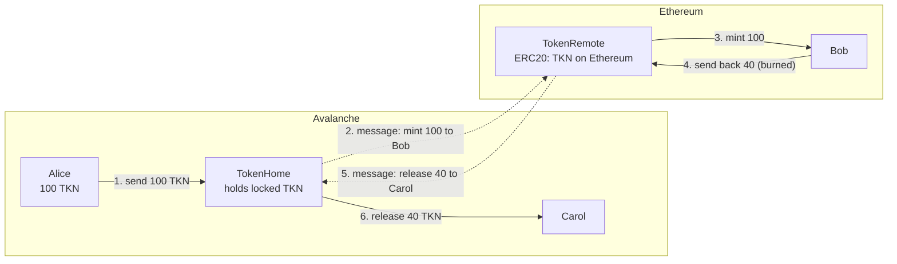
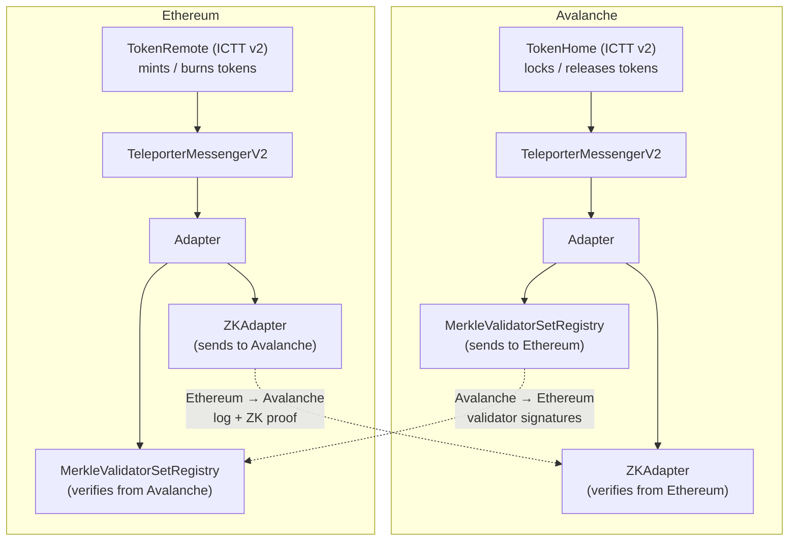
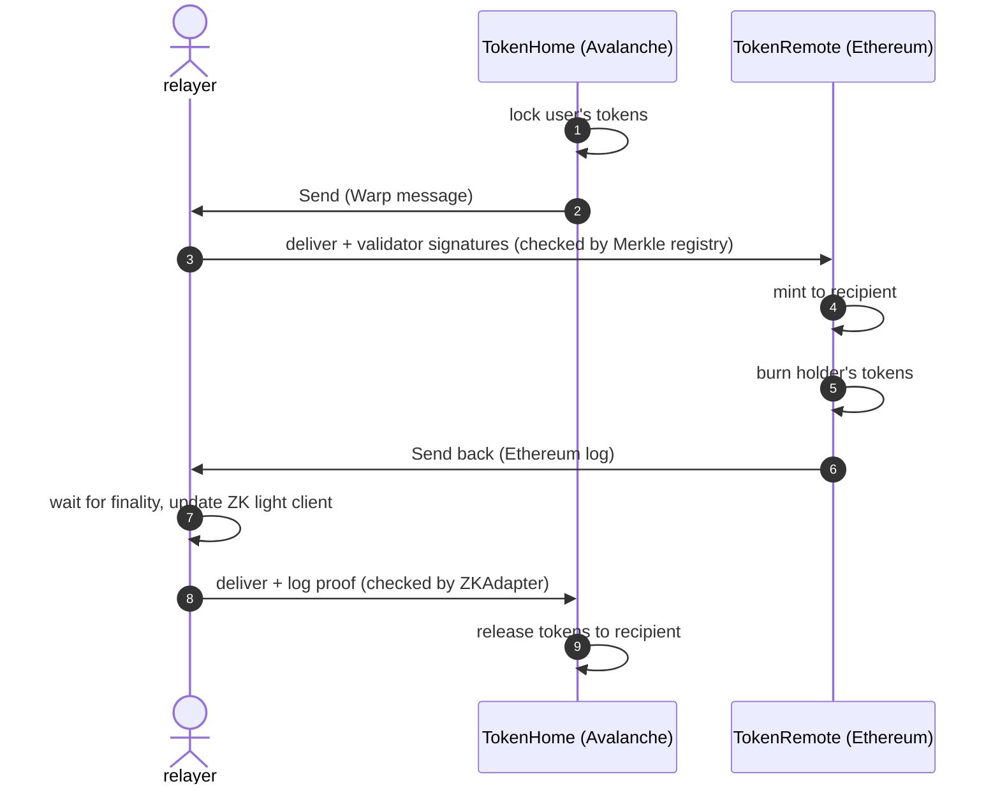

# ICTT v2: Token Transfers over the ICM Avalanche ↔ Ethereum Bridge

Status: Draft. Scope: MVP, bidirectional.

Related: [Teleporter V2 contracts](teleporter_contracts.md), [Message Authentication](icm_message_authentication.md), [Validator set registry](origin_avalanche/validator_set_registry.md), [ZK state verifier](origin_ethereum/zk_state_verifier.md)

Terms used here are defined in the [glossary](CONTEXT.md). Decisions: [ADR-0001](adr/0001-routes-instead-of-teleporter-registry.md), [ADR-0002](adr/0002-ictt-v2-copies-v1-token-logic.md).

## 1. Purpose

ICM now has a new bridge that connects Avalanche chains with Ethereum. It is built on `TeleporterMessengerV2` and carries messages in both directions:

- **Avalanche → Ethereum:** Avalanche validators sign the message. On Ethereum, `MerkleValidatorSetRegistry` verifies the signatures.
- **Ethereum → Avalanche:** the message is emitted as an Ethereum log. On Avalanche, `ZKAdapter` verifies it with a ZK proof of Ethereum consensus.

ICTT (Interchain Token Transfer) is the token bridge application built on ICM. Today ICTT only works with Teleporter V1, which is Avalanche-only. **As a result, ICTT cannot use the new bridge and cannot move tokens to or from Ethereum.**

**This document designs ICTT v2: ICTT made compatible with the new ICM bridge, so tokens can be transferred between Avalanche and Ethereum.**

## 2. How ICTT moves tokens: TokenHome and TokenRemote

ICTT uses two contracts per token.

- **TokenHome** is deployed on the chain where the token originally lives; in this design, Avalanche.
  - It **holds the real tokens**.
  - When a user sends tokens to Ethereum, TokenHome takes them from the user and keeps them locked.
  - When tokens come back, TokenHome releases them to the recipient.
- **TokenRemote** is deployed on the other chain; in this design, Ethereum.
  - It **is itself an ERC20 token**: the Ethereum version of the token.
  - It mints when tokens arrive from Avalanche, and burns when a holder sends them back.
- **Backing rule.** Every token minted by TokenRemote is backed one-for-one by a token locked in TokenHome. TokenHome records how much it has sent to each remote, and it never releases more than that amount.

The two contracts never move tokens across chains themselves. They only exchange messages ("mint 100 to Bob", "release 40 to Carol"), and the ICM bridge carries those messages.

### Example

Alice has 100 TKN on Avalanche. She sends them to Bob on Ethereum. Later, Bob sends 40 back to Carol on Avalanche.

Balances:

- **Start:** Alice has 100 TKN. TokenHome holds 0. TokenRemote supply on Ethereum is 0.
- **After steps 1–3:** Alice has 0. TokenHome holds **100 locked**. Bob has 100, and TokenRemote supply is **100**.
- **After steps 4–6:** Carol has 40. TokenHome holds **60 locked**. Bob has 60, and TokenRemote supply is **60**.

At every point, the tokens locked in TokenHome equal the supply of TokenRemote.

## 3. Architecture: ICTT on top of the new bridge

Three layers:

- **ICTT (TokenHome / TokenRemote).** Moves the tokens: lock, mint, burn, release. ICTT v2 changes this layer.
- **TeleporterMessengerV2.** Delivers each message once and in order. Its interface towards applications is the same as Teleporter V1.
- **Adapter and verifiers.** Sends and verifies messages for each direction. The messenger and its adapters are deployed at the same address on both chains, and each connection (one Avalanche chain ↔ Ethereum) has its own bridge messenger.

A relayer carries messages between the chains. It also keeps the validator-set registry on Ethereum and the ZK light client on Avalanche up to date.

## 4. Why ICTT v1 does not work with the new bridge

ICTT v1 is tied to Avalanche and Teleporter V1 in three places:

- **Finding its messenger.** ICTT v1 gets its messenger from `TeleporterRegistry`. The registry is managed through Warp, which only exists on Avalanche, so it cannot be deployed on Ethereum. On Ethereum, ICTT would have no way to find the bridge messenger.
- **Knowing its own blockchain ID.** ICTT v1 reads its blockchain ID from the Warp precompile. That precompile does not exist on Ethereum, so deployment fails.
- **Trusting messengers.** The registry trusts every registered messenger for every chain. Once the bridge messenger (Avalanche ↔ Ethereum) and the Warp messenger (Avalanche ↔ Avalanche) run on the same chain, each would be trusted for the other's traffic. That is unsafe.

`NativeTokenRemote` is also tied to Avalanche: it mints the chain's native coin through an Avalanche precompile, so it cannot run on Ethereum.

**What already works.** The bridge messenger has the same interface towards applications as Teleporter V1. ICTT's token logic and message format do not need to change; only the parts listed above do.

## 5. What ICTT v2 changes

### 5.1 A route per counterparty chain instead of a registry

ICTT v2 removes `TeleporterRegistry`. Instead, each ICTT contract keeps a **route** for each counterparty chain: the messenger it sends through (the **outbound messenger**) and the messengers it accepts messages from (the **inbound messengers**). See [ADR-0001](adr/0001-routes-instead-of-teleporter-registry.md).

- **Sending to chain X** uses the outbound messenger of X's route. For Ethereum this is the bridge messenger; for an Avalanche L1 it is the Warp messenger.
- **Receiving from chain X** is accepted only from an inbound messenger of X's route. No other messenger can pretend to deliver messages from Ethereum. A route normally has one inbound messenger, which is also its outbound messenger. It has two only while a messenger is being replaced.
- **Pausing.** Pausing a messenger stops sending and receiving through it on every route that uses it. There is no way yet to cut off one chain whose messenger other chains also use (Q6).
- **Replacing a messenger,** for example after a bridge upgrade:
  1. add the new messenger to the route as an inbound messenger;
  2. make it the outbound messenger;
  3. wait until no messages are left in flight on the old messenger;
  4. remove the old one.

  A message that fails to execute is kept by the messenger that delivered it, and it can only be retried through that same messenger. So a message that reaches the old messenger after step 4 fails, and it can be retried only after the owner adds the old messenger back.
- **Who manages the routes:** the contract owner. Adding an inbound messenger for a chain lets that messenger mint or release tokens for that chain, so the owner should be a multisig behind a timelock.

### 5.2 Blockchain ID passed in, not read from Warp

- The blockchain ID is set when the contract is initialized.
- When the owner adds a messenger, ICTT checks that the messenger reports the same blockchain ID.
  - A messenger that reports zero is also accepted, because a Teleporter V1 messenger learns its blockchain ID only when it is first used.
  - A `TeleporterMessengerV2` also reports zero until it is initialized. Deployment must therefore initialize the bridge messenger before adding it to a route.
- Avalanche chains use their normal blockchain ID. Ethereum uses its EVM chain ID as a 32-byte value, which is the same ID the bridge uses.

### 5.3 What stays the same

- **Message types and encoding.** A v1 contract and a v2 contract can talk to each other over the same messenger.
- **Token behaviour:** lock/mint/burn/release, decimal scaling, the backing rule, send-and-call, and multi-hop.

### 5.4 One behaviour change

In v1, any Avalanche chain could register a remote with a Home. In v2, the Home owner must first add a route for that chain. This is intended: the owner decides which bridges the Home's locked tokens are exposed to.

## 6. Scope and decisions

- **D1.** The MVP is bidirectional: Avalanche → Ethereum and Ethereum → Avalanche.
- **D2.** Avalanche → Ethereum messages are verified by `MerkleValidatorSetRegistry` (BLS signatures).
- **D3.** Ethereum → Avalanche messages are verified by `ZKAdapter` (ZK proof).
- **D4.** The main setup is TokenHome on Avalanche and TokenRemote on Ethereum. The same contracts also allow a Home on Ethereum, but that setup is not an MVP target.

Contracts per chain:

- ERC20 Home and ERC20 Remote: both chains.
- Native Home: both chains. On Ethereum it uses WETH.
- Native Remote: Avalanche only, because Ethereum cannot mint its native coin.

Not in scope:

- **Changing how the bridge verifies messages.** ICTT v2 uses the bridge as it is; verification belongs to the bridge's own design.
- **A relayer fee model.** For the MVP, an operator runs the relayer and users pay no relayer fee.
- **Non-EVM chains.**

## 7. Flows

- **Register the Remote (Ethereum → Avalanche).** The TokenRemote on Ethereum sends a registration message to the TokenHome. It arrives after Ethereum finality and a ZK light-client update. Until it arrives, the Home cannot send tokens to that Remote.
- **Send to Ethereum (Avalanche → Ethereum).** TokenHome locks the tokens. The relayer collects validator signatures and delivers to Ethereum. TokenRemote mints.
- **Send back (Ethereum → Avalanche).** TokenRemote burns the tokens. The relayer proves the Ethereum log and delivers to Avalanche. TokenHome releases them.
- **Multi-hop (Ethereum → TokenHome → another Avalanche L1, and the reverse).** TokenHome receives over the bridge messenger and forwards over the L1's messenger.

## 8. Security

- **Each counterparty chain has its own route.** If one connection is broken, only the tokens sent over that connection are at risk. Because of the backing rule, a forged message can take at most the amount locked for remotes on that chain.
- **Tokens minted on Ethereum** depend on the Avalanche → Ethereum direction:
  - at least 67% of the source chain's stake signs;
  - the validator-set registry on Ethereum is updated correctly;
  - the registry was deployed with the correct initial P-chain validator set.
- **Tokens released on Avalanche** depend on the Ethereum → Avalanche direction:
  - the ZK proof of Ethereum finality (Signal / RISC Zero);
  - the light-client admin, who can override the light-client state without a proof and is therefore trusted.
- **The owner of the routes** effectively controls minting and releasing.
- **Cutting off one chain.** Pausing works per messenger, and every Avalanche L1 a Home talks to shares the same Warp messenger. Stopping one compromised L1 today means pausing all of them (Q6).
- **If the bridge stalls** (an out-of-date validator set or a lagging light client), transfers wait. No funds are lost, and messages can be delivered or retried later.

## 9. Operations

- **Speed.** Avalanche → Ethereum takes seconds. Ethereum → Avalanche takes about 15 minutes or more, because it waits for Ethereum finality and a ZK proof. The UI must show a pending state for returns.
- **Gas on Ethereum.** The relayer pays to check validator signatures on Ethereum, and the cost grows with the number of signers. To be measured.
- **Relayer.** For the MVP, an operator runs the relayer in both directions and users pay no relayer fee.
- **Monitoring.** Watch:
  - changes to routes, and pauses;
  - how fresh the validator-set registry is;
  - how far the ZK light client lags;
  - tokens locked in TokenHome compared with TokenRemote's total supply.

## 10. Work breakdown

### 10.1 Contracts

- The routing base layer (`TeleporterRoutedApp`), replacing the registry integration.
- ICTT v2 TokenHome and TokenRemote on that layer, with the blockchain ID passed in: ERC20 Home/Remote and Native Home. Native Remote stays on v1: it only runs on Avalanche L1s and interoperates with a v2 Home over the same messenger.
- Bridge fixes that ICTT needs:
  - `ZKAdapter`: accept calls that come through `Adapter`, which the bridge messenger on Ethereum uses to reach it.
  - `TeleporterMessengerV2`: retrying a failed message compared its hash against a different message format, so no retry could ever succeed.
- Go bindings.

### 10.2 Relayer

- **Avalanche → Ethereum.** Already supported, and verified end to end with ICTT messages through an `Adapter` that carries both directions. In the relayer config, the message contract is the Merkle registry, not the messenger or the `Adapter`, because the registry is what sends the Warp message.
- **Ethereum → Avalanche.** Needs to:
  - read messages from Ethereum after finality;
  - keep the ZK light client on Avalanche updated, including deciding where the proofs come from;
  - build log proofs and deliver them to Avalanche.
- **Configuration.** One connection per Avalanche chain ↔ Ethereum pair, carrying both directions.

### 10.3 Deployment

- Bridge contracts on both chains: Merkle registry, `ZKAdapter`, `Adapter`, messenger.
- ICTT:
  1. deploy TokenHome and TokenRemote;
  2. configure their messengers;
  3. register the Remote.
- Governance:
  - a multisig with a timelock for the routes;
  - admin roles for the registry and the ZK light client.

### 10.4 Testing

- **Unit tests:**
  - the route rules;
  - the existing ICTT tests, ported to v2.
- **Local end-to-end tests:**
  - register, send both ways, send-and-call on Ethereum, multi-hop;
  - a negative test where the wrong messenger tries to deliver;
  - the Ethereum → Avalanche direction is mocked until the ZK relayer is ready.
- **Testnet:** Fuji ↔ Sepolia, with the real bridge and relayer.
- **Gas:** delivery cost on Ethereum.

## 11. Rollout

1. ICTT v2 contracts and unit tests.
2. **Avalanche → Ethereum first**, locally, over the real Merkle/BLS verifier. Remote registration still travels Ethereum → Avalanche, so that one message uses the mock verifier for now.
3. Ethereum → Avalanche: relayer support for the ZK verifier, then sending tokens back and multi-hop from Ethereum.
4. Testnet: Fuji ↔ Sepolia.
5. Audit of ICTT v2 and the bridge, then mainnet.

### 11.1 Progress checklist

#### Phase 1: Contracts

- [x] Routing base layer (`TeleporterRoutedAppUpgradeable` and its Ownable variant)
- [x] ICTT v2 contracts in `icm-contracts/common/ictt-v2/`:
  - [x] TokenHome and TokenRemote
  - [x] ERC20 Home and ERC20 Remote
  - [x] Native Home
  - [x] Upgradeable versions of each
- [x] `ZKAdapter` accepts calls coming through `Adapter`
- [x] Unit tests:
  - [x] routing layer
  - [x] ICTT v1 suites ported to v2
  - [x] `ZKAdapter`
- [x] Go bindings for ICTT v2, and `ZKAdapter` bindings regenerated
- [x] `forge fmt` (v1.0.0, the version CI uses) and solhint pass
- [x] Commit and push (`decentrio/hieu/ictt-v2`)
- [ ] Native Remote on v2 (deferred; v1 Native Remote works with a v2 Home)

#### Phase 1b: Fixes after review

- [x] Design doc:
  - [x] §12: in-place upgrade from v1 is not supported yet
  - [x] §5.1: routes, and how to replace a messenger without losing retries
  - [x] §5.2: messengers that report a zero blockchain ID
  - [x] terms aligned with the [glossary](CONTEXT.md); Q6 added
- [x] Glossary, ADR-0001 and ADR-0002
- [x] Un-audited notice on every deployable v2 contract
- [x] v2 settings struct renamed to `TokenRemoteSettingsV2`, so it no longer shares v1's name
- [x] `TeleporterMessengerV2` can retry a failed message (bug fix, with tests)
- [x] Unit tests:
  - [x] storage slots of the routing layer and of ICTT v2
  - [x] retrying a message after its messenger was replaced
  - [x] v1 NativeTokenRemote with a v2 Home
  - [x] Native Home with WETH9, directly and behind a proxy
- [x] Go bindings regenerated

#### Phase 2: Avalanche → Ethereum (local)

- [x] Test helpers:
  - [x] deploy the bridge (`Adapter` and messenger, both directions) on both chains
  - [x] deploy ICTT v2 and configure routes
- [x] Register the Remote. This goes Ethereum → Avalanche, so it uses the mock verifier and a manual relay.
- [x] Send Avalanche → Ethereum over the real Merkle/BLS verifier; the Remote mints
- [x] Send-and-call to a contract on Ethereum
- [x] Unit tests: a separate mock messenger per remote chain, and multi-hop to a remote on another chain, so a second hop sent through the wrong messenger fails
- [x] E2E: a relay for each direction, with the relayer, mock and Warp relays as adapters, and events matched by the contract that emitted them. The existing Merkle flow keeps its own setup: it tests how the registry is wired, not ICTT.
- [x] Multi-hop: C-Chain → Home → Ethereum (Warp to the Home, the bridge from it)
- [x] Negative test: a second messenger on the L1 delivers a message from Ethereum that its verifier accepts, and the Home rejects it. The bridge's messenger then delivers the same message and the Home releases the tokens.
- [x] Rebase onto `main` for #1529 (P-chain height fix in the relayer's Merkle validator updater)
- [x] Avalanche → Ethereum delivered by the relayer instead of a manual relay

#### Phase 3: Ethereum → Avalanche

- [ ] Relayer: Ethereum as a source chain
  - [ ] config
  - [ ] read finalized blocks only
  - [ ] skip Avalanche-only steps
- [ ] Relayer: register the `zk` protocol in the message handler factory
- [ ] Relayer: ZK message delivery
  - [ ] wait until the message's slot is provable
  - [ ] build the proofs
  - [ ] deliver
  - [ ] retry
- [ ] Relayer: start the ZK consensus updater, and add its config
- [ ] Relayer: check the Avalanche destination client can send a non-Warp delivery transaction
- [ ] Relayer: config for a connection carrying both directions
- [ ] End-to-end:
  - [ ] the ZK relay as a new adapter of the e2e connection
  - [ ] register the Remote over the real ZK verifier instead of the mock
  - [ ] send back Ethereum → Avalanche over the real ZK verifier (works today over the mock verifier)
  - [ ] multi-hop: Ethereum → Home → another Avalanche L1

#### Phase 4: Testnet (Fuji ↔ Sepolia)

- [ ] Deployment scripts:
  - [ ] bridge contracts via Nick's method
  - [ ] ICTT v2
  - [ ] routes and Remote registration
  - [ ] check each messenger is initialized before it is added to a route
- [ ] Relayer config for testnet
- [ ] Governance:
  - [ ] multisig and timelock for routes
  - [ ] admin roles for the registry and the ZK light client
- [ ] Runbook: replacing a messenger (wait until it is drained before removing it)
- [ ] Measure delivery gas on Ethereum
- [ ] Transfers in both directions on testnet

#### Phase 5: Audit and mainnet

- [ ] Sign the commits and open a PR upstream
- [ ] Resolve open questions Q1–Q6
- [ ] If Q5 is yes: migration from v1 to v2 (sets the blockchain ID and the routes), with tests
- [ ] Audit ICTT v2 and the bridge
- [ ] Mainnet deployment

## 12. Existing ICTT v1 deployments

- New deployments use v2.
- The message format is unchanged, so v1 and v2 contracts keep working together. A unit test runs a v1 NativeTokenRemote against a v2 Home.
- **Upgrading a v1 proxy to v2 in place is not supported yet.**
  - v2 keeps v1's storage layout.
  - But v2 has no migration step. After an upgrade the contract would have no blockchain ID and no routes, and it could not be configured.
  - Supporting it needs a migration that copies the stored blockchain ID and adds a route for each chain the contract already talks to. Whether to build it depends on Q5.

## 13. Alternatives considered

Recorded in [ADR-0001](adr/0001-routes-instead-of-teleporter-registry.md) and [ADR-0002](adr/0002-ictt-v2-copies-v1-token-logic.md).

- **A registry on Ethereum that does not use Warp.** It would still trust every messenger for every chain, and it cannot use different messengers for different chains.
- **One fixed messenger per ICTT contract.** A TokenHome could not serve Avalanche L1s and Ethereum at the same time, and switching to a new bridge messenger would require redeploying the token contracts.

## 14. Open questions

- **Q1.** Should a TokenHome on Avalanche still let Avalanche L1s register without the owner adding them first? Ethereum would always require explicit setup.
- **Q2.** Should Ethereum remotes have transfer limits at launch, or are pausing and monitoring enough?
- **Q3.** What fee model should relayers use, and who pays for Ethereum → Avalanche proofs?
- **Q4.** Who generates the ZK proofs for Ethereum (our own prover or a proving service), and what are the cost and the SLA?
- **Q5.** Do any existing v1 deployments need to be upgraded to v2 in place? If so, the migration in §12 has to be built.
- **Q6.** How should one counterparty chain be cut off when other chains use the same messenger? Options: pause a single route, or allow removing a route's outbound messenger.
